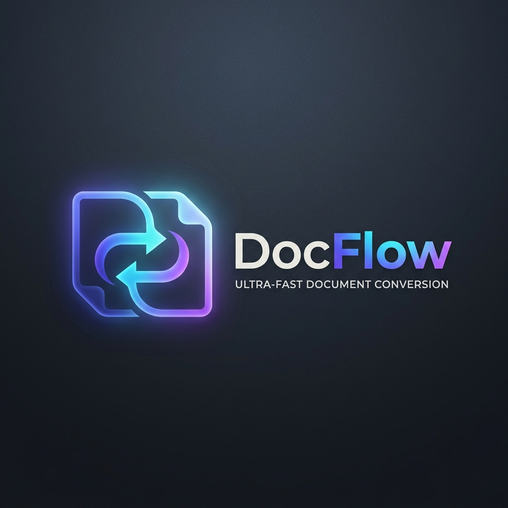

<div align="center">



# DocFlow — PDF & Docs Converter Suite 📄⚡

**High-Fidelity, Zero-Glitch, Privacy-First Document Conversion.**  
Convert **PDF to DOCX** and **DOCX to PDF** with layout preservation, plus native PDF utilities (Compress, Merge, Split).

[](https://github.com/shiwa/PDF-Docs-Converter/actions/workflows/deploy-pages.yml)
[](https://github.com/shiwa/PDF-Docs-Converter/actions/workflows/ci.yml)
[](LICENSE)

</div>

---

## 🌟 What This Project Does (Plain English)

Most online file converters break document formatting—tables get scrambled, fonts disappear, and your private files are uploaded to third-party ad-ridden servers.

**DocFlow** solves this:
1. **Flawless Formatting:** When you convert a PDF into Microsoft Word (`.docx`), it reconstructs paragraphs, tables, colors, and margins as editable elements.
2. **True 1:1 PDF Generation:** When you convert Word to PDF, it renders exact page layouts using Headless LibreOffice and embedded ReportLab styling.
3. **100% Privacy Guarantee:** Zero files are kept. Documents are processed in temporary memory sandboxes and deleted immediately after you download them.
4. **100% GitHub-Native:** Deploys via **GitHub Pages** and **GitHub Container Registry**—no third-party cloud hosting needed.

---

## 🏗️ Clean, Human-Readable Codebase

The entire codebase is commented with high-level professional architectural context. Anyone—engineers, product managers, or non-technical stakeholders—can inspect any file and immediately understand what each part does:

```
PDF-Docs-Converter/
├── frontend/
│   ├── index.html           # Accessible single-page web app with OpenGraph meta tags & icons
│   ├── css/style.css        # Minimalist dark-theme design with ambient glowing effects
│   ├── js/app.js            # User interface controller, upload progress, & client-side engine
│   └── assets/              # DocFlow brand logos, SVG favicon, and OpenGraph social banner
├── backend/
│   └── app/
│       ├── main.py          # FastAPI application server, static assets, and CORS security
│       ├── config.py        # File size limits (100MB) & 10-minute auto-purge lifecycle
│       ├── api/             # HTTP endpoints: /convert, /tools (compress/merge/split), /health
│       ├── core/            # Magic-byte security validation & ephemeral file sandbox manager
│       └── services/        # Layout reconstruction (pdf2docx) & rendering engines
├── docs/
│   ├── context.md           # Vision, quality mandates, and feature specifications
│   ├── architecture.md      # System blueprints and conversion sequence diagrams
│   └── implementation.md    # API contracts, error boundaries, and Docker specs
├── .github/workflows/
│   ├── deploy-pages.yml     # Automatically deploys frontend to GitHub Pages on git push
│   ├── ci.yml               # Automated test runner with LibreOffice verification
│   └── docker-publish.yml   # Builds & publishes container to GitHub Container Registry (GHCR)
├── run.bat & run.ps1        # 1-Click launcher scripts for Windows
└── Dockerfile               # Production container with Python, LibreOffice, and system fonts
```

---

## 🚀 How to Run Locally

### Option 1: 1-Click Launch (Windows)
Double-click `run.bat` or run in PowerShell:
```powershell
.\run.ps1
```
*The launcher checks your environment, starts the server, and automatically opens `http://localhost:8000` in your browser.*

---

### Option 2: Terminal Run
```powershell
# 1. Activate environment
.\.venv\Scripts\activate

# 2. Start server
python -m uvicorn backend.app.main:app --host 127.0.0.1 --port 8000 --reload
```
- **Web App:** [http://localhost:8000](http://localhost:8000)
- **Interactive API Documentation:** [http://localhost:8000/docs](http://localhost:8000/docs)

---

### Option 3: Docker (1-Command Containerized Run)
```bash
docker compose up --build
```

---

## 🌐 100% GitHub-Only Deployment

This project is built to live and deploy **exclusively within GitHub**:

### 1. Push to GitHub
```bash
git branch -M main
git remote add origin https://github.com/<YOUR-USERNAME>/PDF-Docs-Converter.git
git push -u origin main
```

### 2. Live Web Deployment (GitHub Pages)
The included [`.github/workflows/deploy-pages.yml`](./.github/workflows/deploy-pages.yml) workflow deploys the website automatically:
1. In your GitHub repository, go to **Settings** ➔ **Pages**.
2. Under **Build and deployment** ➔ **Source**, select **GitHub Actions**.
3. Push to `main`! Your tool will be live at `https://<YOUR-USERNAME>.github.io/PDF-Docs-Converter/`.
   - *Note:* On GitHub Pages, the frontend automatically runs PDF Merge and Split **directly in the client's browser** via client-side WebAssembly/PDF-lib with zero server required, and connects to the local server for heavy DOCX conversion.

### 3. Container Hosting (GitHub Container Registry - GHCR)
The included [`.github/workflows/docker-publish.yml`](./.github/workflows/docker-publish.yml) builds the full backend container and hosts it on GitHub Packages:
```bash
docker run -p 8000:8000 ghcr.io/<YOUR-USERNAME>/pdf-docs-converter:latest
```

---

## 🧪 Automated Testing

Verify the conversion engines anytime:
```powershell
.\.venv\Scripts\python.exe -m pytest tests/ -v
```
All 5 test suites (PDF ➔ DOCX, DOCX ➔ PDF, Compression, Merge/Split, and Zero-byte guards) pass in ~3.8 seconds.

---

## 📜 License
MIT License. Open-source and free for personal and commercial use.
