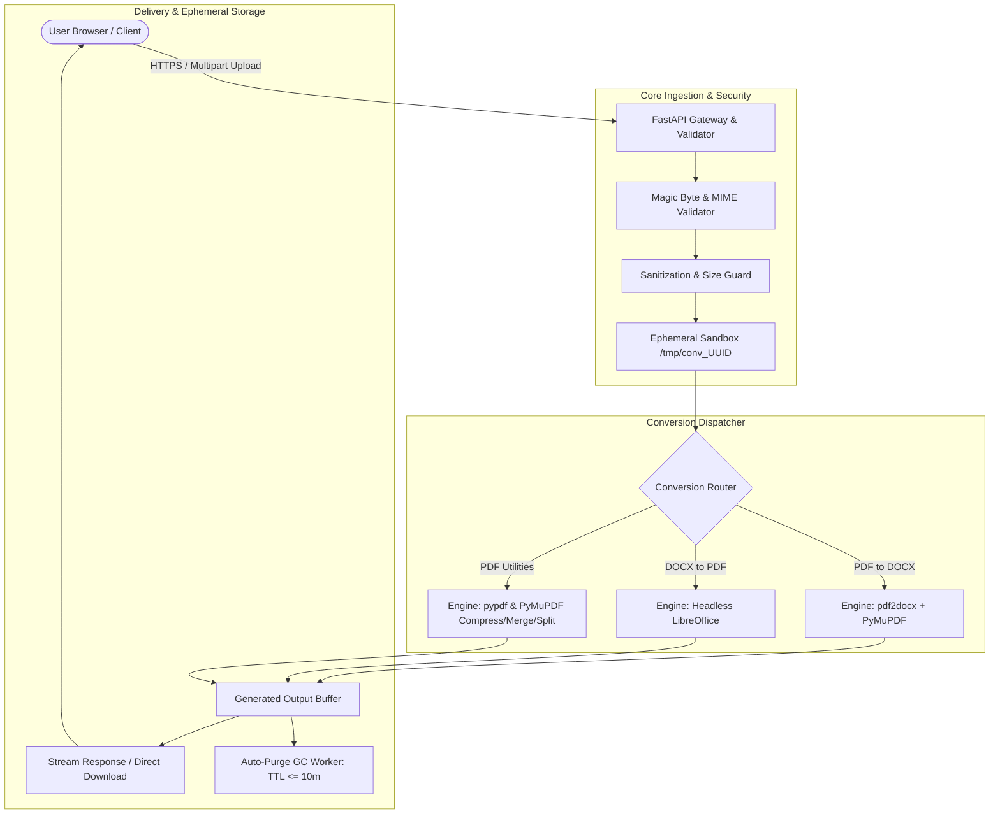
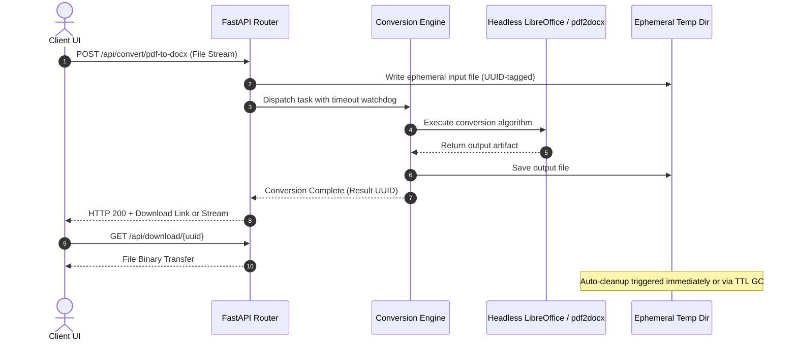

# System Architecture & Technical Design

> **Document:** Architecture Specification  
> **Target Audience:** Engineers, DevOps, Contributors  
> **Status:** Final Proposed Architecture  

---

## 1. High-Level Architecture Overview

The system utilizes an asynchronous, decoupled, modular architecture designed for high throughput, predictable memory usage, and zero data leakage. It comprises three key layers:

1. **Client Presentation Layer:** Minimalist, fast, and accessible Web UI with real-time feedback.
2. **API & Orchestration Gateway:** Lightweight Python FastAPI backend managing ingestion, validation, rate limiting, and task dispatching.
3. **Conversion & Rendering Engines:** Sandboxed conversion workers utilizing specialized libraries (`pdf2docx`, Headless LibreOffice, `PyMuPDF`, `pypdf`) with automated garbage collection.



---

## 2. Technology Stack & Rationale

| Component | Technology | Rationale |
|---|---|---|
| **Backend Framework** | **Python 3.11+ / FastAPI** | High async I/O performance, native typing, automated OpenAPI docs, and rich ecosystem for document parsing. |
| **PDF ➔ DOCX Engine** | **`pdf2docx` (PyMuPDF + python-docx)** | The premier open-source engine for extracting text blocks, table gridlines, images, and font styles into structured OpenXML (`.docx`). |
| **DOCX ➔ PDF Engine** | **LibreOffice Headless (`soffice`)** | Provides true 1:1 fidelity pagination, font embedding, and layout parity matching Microsoft Office across Linux, Windows, and macOS. |
| **PDF Manipulation** | **`PyMuPDF` (`fitz`) & `pypdf`** | High-speed C-extensions for lightning-fast merging, splitting, metadata stripping, and stream re-compression. |
| **Frontend UI** | **Modern Vanilla JS / CSS or React + Vite** | Minimalist aesthetic, zero bloated runtime, responsive drag-and-drop, real-time conversion progress, dark/light theme. |
| **Containerization** | **Docker & Docker Compose** | Encapsulates system dependencies (LibreOffice, Liberation/Core Fonts, Python runtimes) in a reproducible environment. |
| **Deployment Targets** | **Render / Railway / Fly.io / Self-hosted VPS** | Native container support with low baseline memory footprint (< 512MB idle, < 1GB under load). |

---

## 3. Subsystem Breakdown

### 3.1 File Ingestion & Validation Subsystem
To guarantee **"no glitch, no error, no mess"**, the ingestion pipeline enforces strict defensive checks before any conversion process begins:

1. **Magic Number Inspection:** Rejects renamed or malicious extensions by inspecting the file binary signature (e.g., `%PDF-` header for PDFs, `PK\x03\x04` for DOCX zip bundles).
2. **Size Enforcement:** Configurable upper thresholds (default: 50MB for single files, 150MB for batch packages).
3. **Integrity & Encryption Check:**
   - Detects password-protected PDFs immediately and informs the user before conversion fails cryptically.
   - Verifies XML schema integrity on uploaded DOCX archives.

### 3.2 Conversion Engine Pipeline



#### Detailed Pipeline Strategies:

1. **PDF to DOCX:**
   - Uses `pdf2docx.Converter` to analyze document layout hierarchy:
     - *Phase 1:* Segment raw shapes, text runs, and embedded raster images.
     - *Phase 2:* Reconstruct table grids (borders, cells, merged spans).
     - *Phase 3:* Parse multi-column text and inline formatting (bold, italic, font sizes, color).
     - *Phase 4:* Synthesize the `.docx` document conforming to the ECMA-376 OpenXML standard.

2. **DOCX to PDF:**
   - Invokes headless LibreOffice:
     ```bash
     soffice --headless --convert-to pdf:writer_pdf_Export --outdir /tmp/conv_UUID /tmp/conv_UUID/input.docx
     ```
   - Bundles open-source font packs (`fonts-liberation`, `fonts-dejavu`, `ttf-mscorefonts-installer`) into the runtime container to eliminate font-substitution artifacts.

3. **PDF Compression & Optimization:**
   - Analyzes internal PDF objects: deduplicates embedded font subsets, re-compresses uncompressed PDF streams using Deflate, and downsamples high-DPI raster images to web-optimized 150 DPI without compromising legible text.

---

## 4. Ephemeral Storage & Garbage Collection (Zero-Mess Guarantee)

A critical vulnerability of conversion tools is disk exhaustion and user data leaks caused by orphaned temporary files. This project guarantees a zero-mess footprint via a two-layer cleanup strategy:

1. **Synchronous Cleanup Hook:** Upon completion of the file download stream (`StreamingResponse`), an asynchronous background hook unlinks the temporary working directory immediately.
2. **Periodic Garbage Collection Daemon:** A lightweight background thread runs every 5 minutes and deletes any temporary file or directory older than a configurable TTL (default: 10 minutes) to catch aborted downloads or broken network sessions.

---

## 5. Frontend Architecture & Design Philosophy

The user interface follows a **focused, distraction-free, minimalist design**:

- **Visual Tone:** Sophisticated dark/light palette, subtle glassmorphism cards, clear typographic hierarchy (Inter/Outfit font).
- **Interactive State Machine:**
  - `IDLE`: Clean drop-zone with supported format badges.
  - `FILE_SELECTED`: File metadata preview (name, size, target format selector).
  - `CONVERTING`: Animated pulse/progress bar with elapsed time.
  - `SUCCESS`: Instant download button with file size summary + "Convert Another" action.
  - `ERROR`: Clear, user-friendly diagnostic alert (e.g., "File is password-protected" instead of a raw stack trace).

```
┌────────────────────────────────────────────────────────┐
│               Minimalist Converter Card                │
│                                                        │
│   ┌────────────────────────────────────────────────┐   │
│   │          [ 📄 Drag & Drop PDF / DOCX ]         │   │
│   │          or click to browse from device        │   │
│   └────────────────────────────────────────────────┘   │
│                                                        │
│   Target:  (●) Convert to DOCX    ( ) Convert to PDF   │
│                                                        │
│   [        🚀 Convert Now (Instant & Free)        ]   │
└────────────────────────────────────────────────────────┘
```

---

## 6. Deployment Architecture

```
                  ┌───────────────────────────────┐
                  │       Client Browser          │
                  └──────────────┬────────────────┘
                                 │ HTTPS (Port 443)
                                 ▼
                  ┌───────────────────────────────┐
                  │    Reverse Proxy / CDN        │
                  │ (Cloudflare / NGINX / Caddy)  │
                  └──────────────┬────────────────┘
                                 │
                 ┌───────────────┴───────────────┐
                 │                               │
                 ▼                               ▼
       ┌───────────────────┐           ┌───────────────────┐
       │ Docker Container  │           │ Local Standalone  │
       │ (Linux + Python + │           │ (Uvicorn / CLI)   │
       │  LibreOffice)     │           │                   │
       └───────────────────┘           └───────────────────┘
```

- **Dockerized Single-Container Model:** Packages the FastAPI application, static frontend assets, LibreOffice binary, and font libraries into a single production-ready image (`Dockerfile`).
- **Zero External Database Requirement:** Operates completely stateless, removing dependencies on PostgreSQL/Redis for basic operation, enabling zero-cost deployments on free-tier container platforms.
